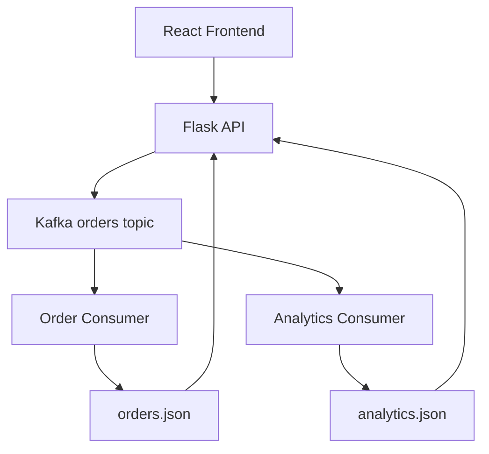

# Distributed OrderFlow

A small full-stack order pipeline demonstrating how a Flask API publishes events to Apache Kafka and how two independent consumer groups process each event for separate purposes.

## Problem statement

A conventional request handler couples order intake, order storage, and reporting. Distributed OrderFlow separates those responsibilities: the API accepts and publishes an order, then independent Kafka consumers update the order list and analytics projection. This demonstrates asynchronous event processing without a database or unnecessary services.

## Features

- Responsive React dashboard with order entry, processed orders, and live aggregate cards.
- Flask endpoints for publishing orders and reading consumer-produced JSON projections.
- One Kafka topic with independent order and analytics consumer groups.
- JSON-file persistence; no database required.
- Docker Compose startup, pytest coverage, GitHub Actions CI, and a pre-push hook.

## Technologies

React, Vite, Axios, plain CSS, Python, Flask, kafka-python, Apache Kafka, Docker Compose, pytest, and GitHub Actions.

## Architecture



The frontend sends `POST /orders` to Flask. Flask assigns an order ID and publishes the order to the single `orders` topic. The `order-processors` group stores each order in `data/orders.json`; the separate `analytics-processors` group updates `data/analytics.json`. Kafka delivers the same topic events independently to both groups. The UI polls the read endpoints so its totals and recent-order list reflect consumer updates.

Revenue is the sum of the submitted `amount` values (the amount is the order amount, as displayed in the form and order table).

## Frontend screenshots

_Add a screenshot of the running dashboard here._

Suggested location: `docs/screenshots/dashboard.png`.

## Run with Docker

Requirements: Docker Desktop with Docker Compose v2.

From the repository root:

```powershell
docker compose up --build
```

Open [http://localhost:5173](http://localhost:5173). The Flask API is also available at [http://localhost:5000](http://localhost:5000). Stop the stack with `Ctrl+C`; run `docker compose down` to remove the containers. The JSON files remain in `data/` on the host.

## Run locally

Requirements: Python 3.10+, Node.js 20+, npm, Git, and Docker (for the Kafka broker).

1. Start only the Kafka broker: `docker compose up -d kafka`.
2. In a PowerShell terminal at the repository root, create/activate a virtual environment and install dependencies:

   ```powershell
   py -3 -m venv .venv
   .\.venv\Scripts\Activate.ps1
   python -m pip install -r backend/requirements.txt
   ```

3. In three separate terminals at the repository root, run the API and both consumers:

   ```powershell
   python -m backend.app
   ```

   ```powershell
   python -m consumer.order_consumer
   ```

   ```powershell
   python -m consumer.analytics_consumer
   ```

4. In another terminal, start the frontend:

   ```powershell
   cd frontend
   npm install
   npm run dev
   ```

5. Open [http://localhost:5173](http://localhost:5173). Vite proxies `/orders` and `/analytics` to the local Flask API. For a clean stop, use `docker compose down` from the repository root to stop Kafka.

## API

- `POST /orders` accepts `product`, positive integer `quantity`, and positive numeric `amount`; returns `message` and `order_id` after Kafka acknowledges the event.
- `GET /orders` returns the order consumer's processed list.
- `GET /analytics` returns `total_orders` and `total_revenue` maintained by the analytics consumer.

If Kafka is unavailable, order creation returns HTTP 503. Consumer-owned JSON files are created as events are processed.

## Run tests

From the repository root, install backend dependencies and run:

```powershell
python -m pip install -r backend/requirements.txt
pytest -q
```

The suite tests valid publishing, rejected input, persisted analytics calculations, and API read endpoints. Kafka is mocked for API tests and is not required to run the test suite.

## GitHub Actions

`.github/workflows/ci.yml` runs on every push and pull request. It checks out the repository, installs Python dependencies, and runs `python -m pytest -q`. A failed test fails the workflow.

## Pre-push hook

The hook at `scripts/pre-push` runs `pytest -q` and exits unsuccessfully if tests fail. Install it in PowerShell from the repository root:

```powershell
New-Item -ItemType Directory -Force .git/hooks | Out-Null
Copy-Item scripts/pre-push .git/hooks/pre-push -Force
```

Git for Windows invokes hook scripts using its shell. The hook requires `pytest` to be installed in the active Python environment. You can also run `pytest -q` manually before pushing.

## Expected output

After placing an order, the dashboard reports that its `ORD...` ID was sent to Kafka. The order consumer prints a line like `[ORDER CONSUMER] Processed ORD001`. The analytics card and recent-orders table update after the consumers process the event. An order with amount ₹50,000 increases total revenue by ₹50,000.

## Future improvements

- Add Kafka retry/dead-letter handling and consumer observability.
- Add pagination and date-range analytics.
- Use a durable shared store if the demo grows beyond a single host.
- Add end-to-end tests that run against a temporary Kafka stack.
